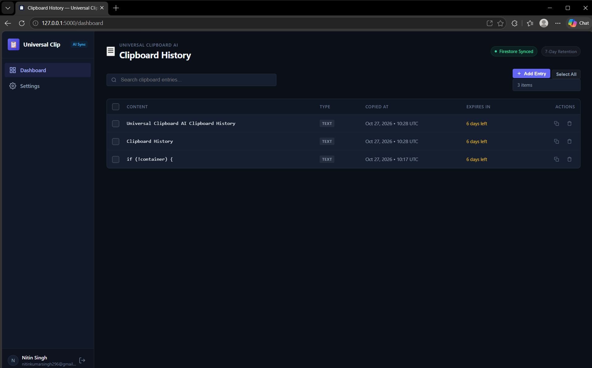

# 📋 UniClip — Smart Cross-Device Clipboard Synchronization

[](https://github.com/nitin-singh202/UniClip)
[](https://www.python.org/)
[](https://opensource.org/licenses/MIT)
[](tests/)

**UniClip** is a fast, privacy-focused, cross-device clipboard synchronization platform. It seamlessly captures and organizes clipboard history between your Windows desktop and mobile devices via an installable Progressive Web App (PWA) and Cloud Firestore backend.

---

## 🖥️ Product Preview



🎬 **[Watch the UniClip Video Demonstration on YouTube](https://youtu.be/yiQI_o59cpw)**

---

## ✨ Key Features

- **⚡ Instant Real-Time Sync**: Copied text and links appear on your dashboard in real time with background polling and automatic DOM reconciliation.
- **🛡️ Pre-Persistence Secret Filtering**: Regex-powered local secret detector automatically catches and drops sensitive tokens, API keys (e.g. OpenAI, Anthropic, Google, AWS, GitHub), private keys, and passwords before saving or syncing.
- **📱 Installable Progressive Web App (PWA)**: Install directly onto Android, iOS, Windows, or macOS via Chrome or Edge with standalone display mode, custom icons, and offline support.
- **🔒 Zero-Content Caching**: Service worker strictly enforces network-first policies for dashboard pages and never caches credentials, tokens, or clipboard contents in browser storage.
- **👤 Guest Mode & Google Authentication**: Test instantly without configuration in local-only Guest Mode (stored in browser IndexedDB), or sign in with Google for cloud synchronization.
- **⏳ 7-Day Automatic Retention**: Automatic timestamp calculation and filtering ensure clipboard history is hygienically kept for 7 days without unbounded growth.
- **🧹 Bulk Operations**: High-density productivity table UI supporting single-click copies, multi-item selection, "Select All", and confirmed bulk deletion.

---

## 🏗️ Architecture

```text
UniClip/
├── desktop_watcher.py       # Windows clipboard listener with secret filtering & SQLite storage
├── app.py                   # Root entrypoint forwarder
├── run.py                   # Unified launcher (web dashboard, desktop watcher, or both)
├── image.png                # Dashboard preview screenshot
├── web/
│   ├── app.py               # Flask application factory with security headers & routes
│   ├── config.py            # Environment validation & production security hardening
│   ├── services.py          # Firebase Auth token verification & Firestore/SQLite abstraction
│   ├── static/
│   │   ├── css/style.css    # Clean dark theme & responsive table styling
│   │   ├── js/app.js        # Mobile-first dashboard, live sync & Guest Mode manager
│   │   ├── js/sw.js         # PWA Service Worker (network-first, zero secret caching)
│   │   ├── manifest.webmanifest # PWA Web App Manifest
│   │   └── icons/           # PWA standard and maskable icons (192px, 512px)
│   └── templates/
│       ├── base.html        # Shared navigation shell & responsive layout
│       ├── dashboard.html   # Main clipboard history view
│       ├── login.html       # Authentication & guest entry point
│       ├── settings.html    # Session information, retention policy & security summary
│       └── offline.html     # Safe network disconnect fallback
└── docs/
    ├── PWA_INSTALLATION_GUIDE.md  # Detailed Android and desktop installation instructions
    ├── SECURITY.md                # Firestore security rules and web security controls
    ├── CLIPBOARD_DATA_SCHEMA.md   # Canonical document specifications
    └── ANDROID_SETUP.md           # Companion mobile guide
```

---

## 🚀 Quick Start & Installation

### 1. Prerequisites
- **Python 3.10+** (Python 3.11 recommended)
- Modern web browser (Google Chrome, Microsoft Edge, Firefox, or Safari)

### 2. Clone Repository & Install Dependencies
```powershell
git clone https://github.com/nitin-singh202/UniClip.git
cd UniClip

# Optional: Set up virtual environment
python -m venv .venv
.\.venv\Scripts\Activate.ps1

# Install requirements
pip install -r web/requirements.txt
```

### 3. Configure Environment
Copy `.env.example` to `.env` inside the `web/` folder:
```powershell
Copy-Item web\.env.example web\.env
```

Key environment options in `web/.env`:
```ini
# Flask session encryption key
SECRET_KEY=change-this-to-a-secure-random-key-in-production

# Fast local test mode (no Firebase setup needed)
DEV_MOCK_AUTH=true

# Database mode: set to false once Cloud Firestore credentials are configured
USE_SQLITE=true
```

### 4. Run UniClip

#### Option A: Run Web Dashboard & Desktop Watcher Simultaneously
```powershell
python run.py all
```

#### Option B: Run Web Dashboard Only
```powershell
python app.py
```
Open **`http://127.0.0.1:5000`** in your browser.

#### Option C: Run Windows Clipboard Watcher Standalone
```powershell
python run.py watcher
```

---

## 📱 Installing the PWA on Mobile / Android

UniClip is a fully compliant Progressive Web App:

1. **Local Android Testing via USB Port Forwarding**:
   - Connect your Android phone to your PC via USB with USB debugging enabled.
   - In desktop Chrome, open `chrome://inspect/#devices` -> **Port forwarding**.
   - Forward port `5000` to `localhost:5000`.
   - On Android Chrome, visit `http://localhost:5000`.
   - Tap **⋮ (Menu) > Install app** or **Add to Home screen**.
2. **Production Deployment**:
   - Host the Flask service with HTTPS (e.g. Render, Cloud Run, or Cloudflare Tunnel).
   - Visit your HTTPS domain on any mobile browser and tap **Add to Home screen**.
   - See [docs/PWA_INSTALLATION_GUIDE.md](docs/PWA_INSTALLATION_GUIDE.md) for full instructions.

---

## 🔒 Security Hardening

- **Production Security Validations**: When `FLASK_ENV=production`, `web/config.py` strictly prevents startup if `DEV_MOCK_AUTH=true`, if `SECRET_KEY` is missing or insecure, or if required Firebase credentials are not provided.
- **Database Partitioning**: Authenticated clipboard records reside in per-user Firestore paths (`/users/{uid}/clipboardEntries/{id}`) guarded by Firestore Security Rules.
- **Guest Isolation**: Guest session data lives exclusively in the local browser via IndexedDB and is never sent to the cloud.
- **CSRF & Modern Headers**: Cryptographic token validation on all mutations, `HttpOnly` + `SameSite=Lax` cookies, and strict CSP/security headers.

---

## 🧪 Testing

Run the automated test suite covering all 65 test cases:

```powershell
python -m pytest
```

Test coverage includes:
- Desktop clipboard listener, duplicate prevention, and secret regex detection
- Web dashboard routes, authentication barriers, and user isolation
- PWA manifest, service worker headers, and offline fallbacks
- Guest mode IndexedDB operations and CSRF protection
- Production config validations and security constraints

---

## 📄 License

This project is licensed under the MIT License — see the LICENSE file for details.
